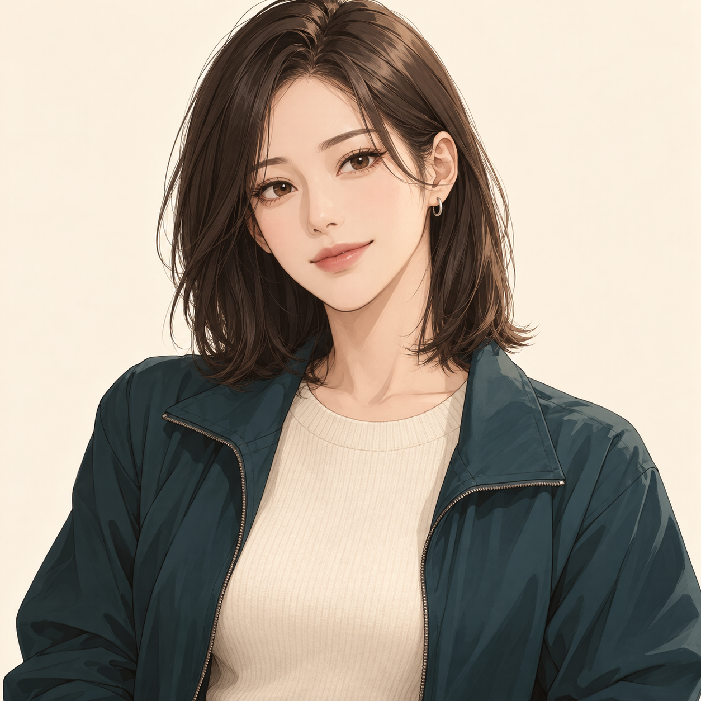
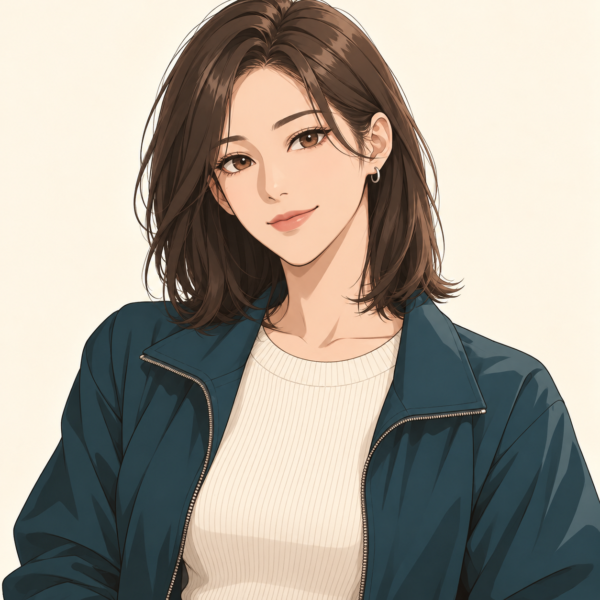

# 서안 얼굴 방향 — A/B 비교

2026-10-20 · 시안 0.2 · 이미지 2장 보관 / 사용자 A안 선택 완료

같은 서안·긴 단발·실버 링·아이보리 니트·청록 집업·크림 배경을 사용했다. B는 A를 참고한 편집으로 만들었다. 동일 인물의 표정 제작 일관성을 검증한 결과가 아니라 얼굴과 그림 표현을 고르기 위한 비교다.

| 비교 | A · 섬세한 일러스트 | B · 웹툰·애니 혼합 |
|---|---|---|
| 얼굴 | 부드러운 피부·입술과 섬세한 눈가 | 또렷한 눈·코·턱선, 간결한 얼굴 명암 |
| 머리·옷 | 잔머리·니트·소재 묘사 많음 | 머리 면과 옷 주름을 더 단순하게 정리 |
| 첫인상에 대한 제작 판단 | 로맨스 일러스트·화보에 가까운 성인 미인 | 대화 중 작은 표정 변화가 읽히는 성인 동료 |
| 장점 | 얼굴의 부드러움과 생활감 | 이번 K웹툰+미연시 목표에 더 가까운 선·명암 |
| 다음 확인 | 축소 시 묘사가 복잡해지는지, 표정 확장 때 마감 유지 | 눈이 어려 보이지 않는지, 진지함과 옅은 웃음 구분 |

**선택 결과: 사용자는 A안을 선택했다.** 현재 제작 기준은 A이며 [표정 4종](SEOAN_EXPRESSIONS.md)을 생성했다. 아래 추천은 선택 전 비교 의견으로 보관한다.

당시 제작 추천은 B였다. 간결한 선·명암이 작은 대화 화면과 표정 교체에 적합할 것으로 판단한다. 실제 모바일 가독성이나 제작 공수 우위는 아직 측정하지 않았다. A의 부드러운 눈가를 B에 일부 반영하는 선택도 가능하다.

## A — 섬세한 웹툰 일러스트 방향

## B — 웹툰·애니 혼합 방향

## 이번 시안의 범위와 다음 작업

- 두 결과의 헤어·옷·색·구도는 유사하지만 얼굴과 선의 세부 형태가 완전히 일치하는 것은 아니다. 인물 동일성 기준은 선택한 한 장에서 고정한다.
- 정수리 위 여백이 부족하다. 본제작에서는 여백과 상반신 크롭을 먼저 정리한 기준 원화로 확장한다.
- 현재는 배경이 포함된 단일 PNG다. 투명 배경·몸/얼굴/출입증 레이어·포즈 전체를 납품 완료한 상태가 아니다.
- A 선택 뒤 기본/옅은 웃음/시선 회피/진지함 네 표정 시안을 생성했다. 최종 위치·가장자리·레이어 마감은 [표정 검토 기록](SEOAN_EXPRESSIONS.md)을 따른다.
- 조연 전신·배경·게임 코드·화면 시안은 이번 단계에서 제작하지 않았다. 얼굴 선택 후 대표 화면 작업으로 이어간다.

실제 입력 문구는 [생성 프롬프트](SEOAN_STUDY_PROMPTS.md), 기준은 [비주얼 브리프](VISUAL_DIRECTION.md), 일정은 [제작 계획](BETA_RUNBOOK.md)을 따른다. 내장 image_gen으로 A 신규 생성 1회·B 편집 1회를 수행했고 프로젝트에 복사해 저장했다. 새 유료 구독·외주·도메인은 구매하지 않았다.
